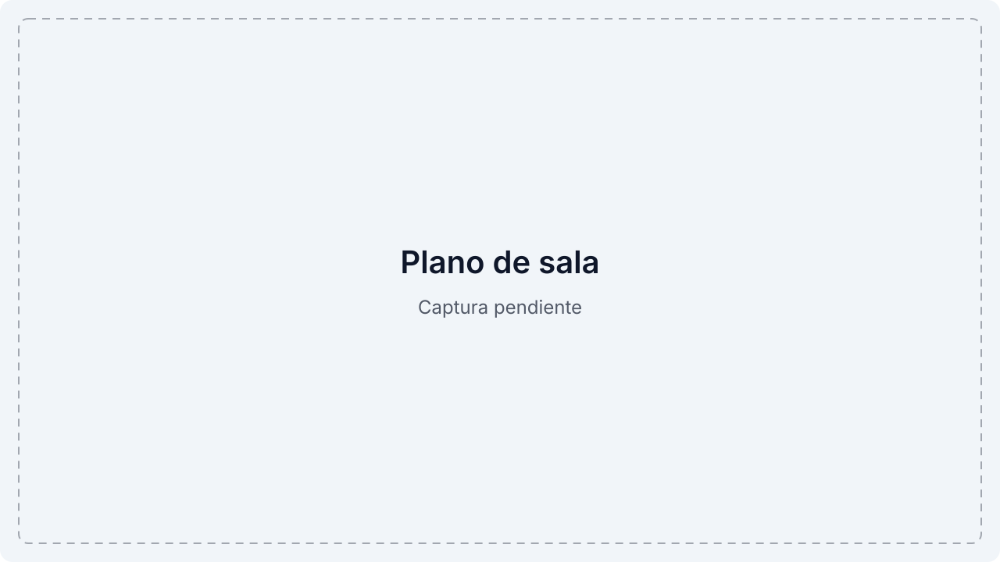
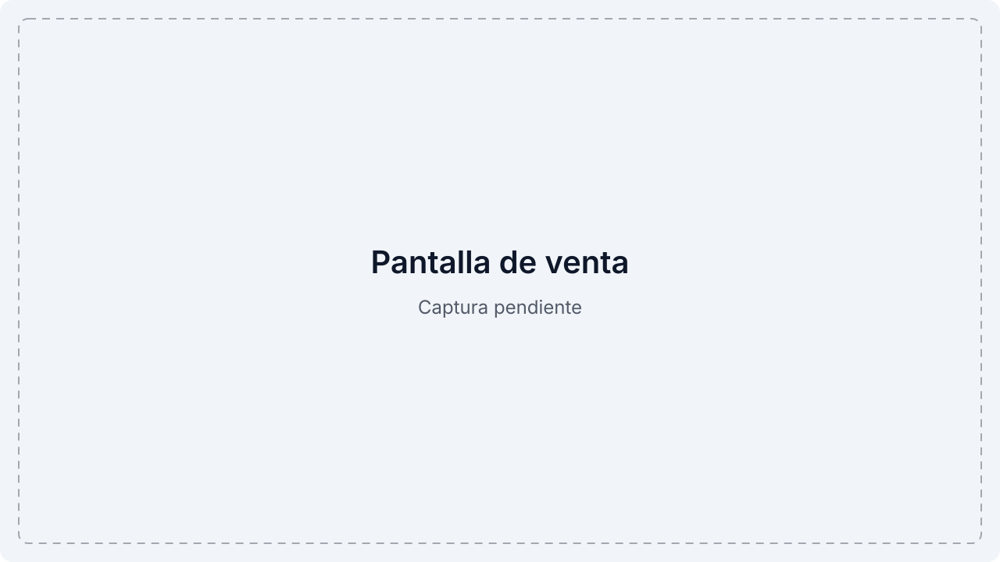
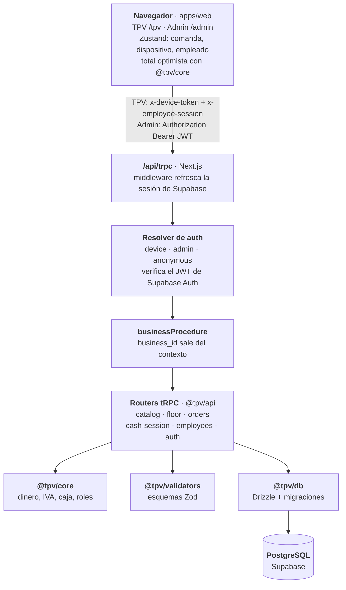

<!--
  TODO: logo. Hoy la cabecera usa el emoji 🧾. Cuando haya logo, sustituirlo por
   encima del título.
  TODO: demo. No hay URL desplegada. Cuando exista, añadir "[Demo](URL) · " al principio de la línea de enlaces.
-->
<div align="center">

# 🧾 TPV Advanced

**TPV para bares y restaurantes: comandas por mesa, cobro, caja e informe Z.**

[](#-roadmap)
[](#-licencia)
[](https://github.com/mkcodev/TPV-Advanced/actions/workflows/ci.yml)
[](#-calidad)
[](https://nextjs.org)
[](https://www.typescriptlang.org)
[](https://trpc.io)
[](https://supabase.com)
[](https://tailwindcss.com)

[Documentación](docs/) · [Reportar un bug](https://github.com/mkcodev/TPV-Advanced/issues/new)

</div>

<!-- TODO: captura real del plano de sala (tema claro y oscuro) en docs/assets/hero-light.jpg y hero-dark.jpg, datos de ejemplo, desde localhost con una BD de desarrollo confirmada. Ahora hay placeholders .svg: cambiar las rutas del <picture>. -->
<picture>
  <source media="(prefers-color-scheme: dark)" srcset="docs/assets/hero-dark.svg">
  
</picture>

<details>
<summary>🇬🇧 English summary</summary>

TPV Advanced is a point-of-sale system for bars and restaurants in Spain, built to run one real family bar and to grow into a multi-venue SaaS.
Today it covers the product catalog, a floor plan with table orders, payments, cash sessions with Z report, employee PIN login and terminal pairing.
Totals are computed by the server in integer cents, and every query is scoped to the business taken from the auth context.
Built solo with Next.js 16, tRPC, Drizzle and Supabase PostgreSQL in a pnpm + Turborepo monorepo, with 421 passing tests and CI on every pull request.
Legal invoicing (Veri\*factu), thermal printing, offline mode and the waiter app are still pending.

</details>

## Contenido

- [¿Por qué existe?](#-por-qué-existe)
- [Funcionalidades](#-funcionalidades)
- [Stack](#-stack)
- [Arquitectura](#-arquitectura)
- [Decisiones técnicas](#-decisiones-técnicas)
- [Calidad](#-calidad)
- [Desarrollo con IA](#-desarrollo-con-ia)
- [Empezar](#-empezar)
- [Roadmap](#-roadmap)
- [Autor](#-autor)
- [Licencia](#-licencia)

## 🎯 ¿Por qué existe?

El mercado de TPV para hostelería está lleno de software antiguo y de empresas que cobran por hardware propietario. Hay hueco para algo moderno, rápido y honesto en precio.

Su autor trabajó años de camarero y conoce el problema desde dentro. El objetivo es doble: llevar el día a día de un bar familiar, que es el uso real, y convertirlo después en un producto SaaS para varios locales. Por eso el proyecto es multi-negocio desde el primer día.

## ✨ Funcionalidades

| Funcionalidad | Qué aporta | Estado |
|---|---|---|
| Catálogo | Categorías y productos con foto, precio e IVA desde el panel de administración | Hecho |
| Plano de sala | Editor de zonas y mesas en el admin; en el TPV, mesas libres, ocupadas y pendientes de cobro con total, tiempo y empleado | Hecho |
| Comandas por mesa y barra | Pantalla de venta con varias comandas abiertas a la vez, guardado optimista y envío a cocina | Hecho |
| Líneas fijadas y anulación | Una línea guardada no se borra: se anula con motivo y PIN de un encargado | Hecho |
| Cobro | Efectivo, tarjeta, Bizum u otro, con teclado de importe y cambio; ticket simplificado imprimible desde el navegador | Hecho |
| Caja e informe Z | Apertura y cierre, movimientos, cierre ciego configurable por negocio y informe Z con totales por empleado | Hecho |
| Empleados y PIN | Alta y baja desde el admin, PIN con bloqueo tras 5 intentos fallidos y roles (worker, manager, admin) | Hecho |
| Terminales | Vinculación por código de 8 dígitos de un solo uso, con revocación desde el admin | Hecho |
| Alta de negocio real | `pnpm db:bootstrap` crea organización y negocio sin datos de demostración | Hecho |
| Facturación Veri\*factu | Registro de facturación encadenado por hash, QR y envío a la AEAT | Pendiente |
| Dividir y juntar cuentas, variantes y modificadores | El esquema ya existe; falta la interfaz | Pendiente |
| Descuentos e invitaciones | Con permiso por rol | Pendiente |
| Impresión ESC/POS, tiempo real y app de camareros | Impresora térmica, sincronización entre dispositivos y PWA | Pendiente |
| Escritorio (Electron) y modo offline | La misma UI web en una caja de escritorio con SQLite local | Pendiente |

<!-- TODO: captura real de la pantalla de venta (tema claro y oscuro) en docs/assets/sale-light.jpg y sale-dark.jpg. Ahora hay placeholders .svg: cambiar las rutas del <picture>. -->
<picture>
  <source media="(prefers-color-scheme: dark)" srcset="docs/assets/sale-dark.svg">
  
</picture>

> [!IMPORTANT]
> Aún no cumple Veri\*factu (RD 1007/2023). La obligación para sociedades llega el 1 de enero de 2027 y para autónomos el 1 de julio de 2027, según `docs/PLANIFICACION-TPV.md`. Los plazos han cambiado varias veces y deben verificarse con la AEAT antes de vender a terceros.

## 🧰 Stack

| Capa | Tecnología | Por qué |
|---|---|---|
| Frontend | Next.js 16 (App Router), React 19 | TPV, admin y landing en una sola app; la misma UI la cargará la caja de escritorio |
| | Tailwind CSS 4, shadcn/ui (Radix) | Todo estilo sale de tokens del design system, sin valores sueltos |
| | Zustand 5 | Estado de la comanda activa por mesa, persistido en el cliente |
| | TanStack Query 5, next-intl 4 | Caché de datos y textos de interfaz por i18n, sin cadenas fijas en los componentes |
| Backend | tRPC 11, Zod 3 | Tipos de extremo a extremo y esquemas de validación compartidos entre cliente y servidor |
| Auth | Supabase Auth, `@node-rs/argon2`, jose | Panel con Supabase Auth; terminales con token de dispositivo y PIN de empleado con hash argon2 y sesión JWT |
| Datos | PostgreSQL (Supabase), Drizzle ORM 0.45 | Esquema tipado en TypeScript y migraciones SQL versionadas (9 en `packages/db/migrations`) |
| Testing y CI | Vitest 2, fast-check | Tests unitarios y property-test del invariante de totales e IVA |
| | GitHub Actions | Lint, typecheck y tests en cada PR |
| Herramientas | pnpm 9, Turborepo 2, Biome 1.9, TypeScript 5.9 | Monorepo con paquetes compartidos, lint y formato en una sola herramienta |

## 🧱 Arquitectura



```text
.
├── apps/
│   ├── web/        Next.js: TPV (/tpv), admin (/admin), handler tRPC, i18n y stores de Zustand
│   ├── desktop/    Reservado para la caja de escritorio (Electron); aún sin código
│   └── mobile/     Reservado para la app de camareros; aún sin código
├── packages/
│   ├── api/        Routers tRPC, procedimientos por rol, resolver de auth y verificación de PIN
│   ├── core/       Lógica pura sin IO: dinero, totales e IVA, pagos, caja, roles, lockout
│   ├── db/         Esquema Drizzle, migraciones SQL, seed y bootstrap de negocio
│   ├── ui/         Componentes shadcn/ui y tokens de diseño
│   └── validators/ Esquemas Zod de entrada compartidos
└── docs/           Esquema de BD, design system, auth, impresión, planificación y roadmap
```

## 🧭 Decisiones técnicas

<details>
<summary><strong>1. Dinero en céntimos y servidor autoritativo para los totales</strong></summary>

- **Contexto:** con dinero real, un redondeo de float o un total enviado por el cliente puede descuadrar la caja o un ticket.
- **Decisión:** todo importe es un entero en céntimos. El cliente calcula para pintar al instante, pero el servidor recalcula con `orderTaxBreakdown` de `@tpv/core` antes de persistir o cobrar e ignora los totales del cliente. El IVA se redondea por bloques de tipo, y un property-test comprueba que base más cuota suman siempre el total.
- **Consecuencia:** los totales son reproducibles y auditables. A cambio, hay que mantener el cálculo duplicado en cliente y servidor, y ambos usan la misma función del paquete compartido.

</details>

<details>
<summary><strong>2. Multi-negocio: <code>business_id</code> siempre del contexto</strong></summary>

- **Contexto:** el producto se venderá a varios locales, y una consulta sin filtro mostraría datos de un bar a otro.
- **Decisión:** ningún endpoint acepta `business_id` como entrada. Un resolver de auth lo deriva del token de dispositivo o del JWT del panel, y `businessProcedure` lo inyecta en el contexto. El diseño prevé RLS en PostgreSQL como segunda defensa.
- **Consecuencia:** la defensa efectiva hoy es `businessProcedure`. La conexión de Drizzle usa el rol `postgres`, que salta RLS, así que está pendiente un rol de mínimo privilegio (issue [#27](https://github.com/mkcodev/TPV-Advanced/issues/27)).

</details>

<details>
<summary><strong>3. Autenticación en dos niveles: terminal y empleado</strong></summary>

- **Contexto:** una tablet de bar la toca mucha gente y el dueño no debe teclear una contraseña en cada pedido.
- **Decisión:** el panel usa Supabase Auth. Cada terminal se vincula con un código de 8 dígitos de un solo uso que caduca a los 15 minutos, canjeado de forma atómica con `FOR UPDATE SKIP LOCKED`. Sobre el terminal, cada empleado entra con su PIN (hash argon2, 5 intentos y 15 minutos de bloqueo) y recibe una sesión JWT ligada a ese dispositivo.
- **Consecuencia:** revocar un terminal o desactivar a un empleado surte efecto en la siguiente petición, porque el resolver lo comprueba en base de datos. No se impone PIN único por negocio: el login es empleado más PIN.

</details>

<details>
<summary><strong>4. Líneas guardadas fijadas y anulación con PIN de encargado</strong></summary>

- **Contexto:** si una línea enviada a cocina se puede borrar o bajar sin rastro, se puede ocultar una venta. Antes, `orders.upsert` borraba cualquier línea ausente del input.
- **Decisión:** una línea guardada queda fijada: `upsert` nunca la borra ni la baja, y una enviada tampoco sube. Solo `voidLine` la anula, con motivo y el PIN de un encargado verificado en servidor, y la línea pasa a `cancelled` sin dejar de existir. Una restricción CHECK en la migración `0008` lo refuerza en la base de datos.
- **Consecuencia:** hay trazabilidad de cada anulación, que además ya no cuenta en totales, cobro, ticket ni cocina. A cambio, corregir un error exige un encargado, y falta el ticket de anulación en cocina (issue [#38](https://github.com/mkcodev/TPV-Advanced/issues/38)).

</details>

<details>
<summary><strong>5. Lógica de negocio en paquetes puros, sin IO</strong></summary>

- **Contexto:** los cálculos de dinero, caja y bloqueo de PIN son los que más duele romper, y deben poder testearse sin base de datos.
- **Decisión:** viven en `@tpv/core` como funciones puras con su `*.test.ts` al lado. Los routers de `@tpv/api` solo orquestan: validan con Zod, leen y escriben con Drizzle y llaman al core.
- **Consecuencia:** la lógica crítica se cubre con tests rápidos, y la misma función sirve al cliente y al servidor. El coste es una capa más de paquetes en el monorepo.

</details>

## ✅ Calidad

- **Tests:** 421 pasan y 1 se salta, en 35 archivos (`pnpm test` sobre `main` en `cfd99a4`, 2026-11-12). Por paquete: `core` 66, `db` 10, `api` 224, `web` 121. Incluyen un property-test con fast-check del invariante de totales e IVA, tests de los routers con una BD simulada y tests de las stores de la comanda.
- **CI:** `.github/workflows/ci.yml` ejecuta `pnpm lint`, `pnpm typecheck` y `pnpm test` en cada PR contra `main` y en cada push a `main`, con Node 24.
- **Lint y tipos:** `pnpm lint` (Biome, 294 archivos) y `pnpm typecheck` terminan con código de salida 0 sobre `main`, 2026-11-12.
- **Sin cubrir:** no hay tests e2e con Playwright todavía. <!-- TODO: Lighthouse. No hay datos medidos; añadir cifras cuando se midan sobre un despliegue. -->

## 🤖 Desarrollo con IA

- **Contexto para el agente:** [`CLAUDE.md`](CLAUDE.md) fija el stack, las reglas de oro y el mapa de archivos. Los documentos de [`docs/`](docs/) son la fuente de verdad que se lee antes de tocar código, y [`docs/ROADMAP-Y-PROMPTS.md`](docs/ROADMAP-Y-PROMPTS.md) recoge las tareas y los prompts del proyecto.
- **Flujo:** cada cambio sale de un issue, vive en una rama y entra por una PR con `Closes #N` y la CI en verde. 11 PRs fusionadas hasta hoy (`gh pr list --state all`, 2026-11-12).
- **Trazabilidad:** los commits no llevan trailers `Co-authored-by` ni `Claude-Session`, así que el historial no permite medir qué parte del código escribió una IA.
- **Red de seguridad:** los 421 tests, el typecheck estricto y Biome corren en cada PR antes de fusionar.

## 🚀 Empezar

**Requisitos:** Node 24 (`.nvmrc`), pnpm 9.12 y un proyecto de Supabase propio. Usa uno de desarrollo: el seed regenera los datos de la cuenta demo.

```bash
git clone https://github.com/mkcodev/TPV-Advanced.git
cd TPV-Advanced
cp .env.example .env      # rellena las variables de la tabla de abajo
pnpm install
pnpm db:migrate           # aplica las migraciones al DATABASE_URL del .env
pnpm db:setup-storage     # crea el bucket de fotos de productos
pnpm db:seed              # cuenta demo, catálogo, mesas, empleados y un terminal vinculado
pnpm dev                  # arranca la web en http://localhost:3000
```

| Variable | Para qué |
|---|---|
| `NEXT_PUBLIC_SUPABASE_URL` | URL del proyecto de Supabase |
| `NEXT_PUBLIC_SUPABASE_ANON_KEY` | Clave pública (anon) de Supabase para el navegador |
| `SUPABASE_SERVICE_ROLE_KEY` | Clave de servicio, solo en servidor y scripts; nunca en el cliente |
| `DATABASE_URL` | Cadena de conexión a PostgreSQL para Drizzle y las migraciones |
| `AUTH_SESSION_SECRET` | Secreto con el que se firman las sesiones JWT de empleado |
| `SUPABASE_JWT_SECRET` | Opcional: solo para proyectos Supabase antiguos con JWT HS256 |

El seed imprime en consola los PIN de los empleados demo y el token del terminal. Para dar de alta un negocio real sin datos de demostración existe `pnpm db:bootstrap` (ver [`docs/PASO-1.md`](docs/PASO-1.md)).

```bash
pnpm lint        # Biome
pnpm typecheck   # tsc en todos los paquetes
pnpm test        # Vitest en todos los paquetes
```

## 📍 Roadmap

Fases del proyecto en [`docs/ROADMAP-Y-PROMPTS.md`](docs/ROADMAP-Y-PROMPTS.md). Lo hecho y los issues abiertos a 2026-11-12:

- [x] Catálogo, plano de sala, comandas, cobro, caja e informe Z
- [x] Empleados con PIN, terminales y anulación con PIN de encargado ([#41](https://github.com/mkcodev/TPV-Advanced/pull/41))
- [ ] Descuentos e invitaciones ([#37](https://github.com/mkcodev/TPV-Advanced/issues/37))
- [ ] Informe Z con IVA desglosado, nº de tickets y todos los métodos ([#16](https://github.com/mkcodev/TPV-Advanced/issues/16))
- [ ] Cerrar comanda sin líneas activas ([#42](https://github.com/mkcodev/TPV-Advanced/issues/42))
- [ ] Login con PIN de 5 a 6 dígitos y botón de confirmar ([#43](https://github.com/mkcodev/TPV-Advanced/issues/43))
- [ ] Editor de mesas: crear varias, duplicar, imán a cuadrícula ([#15](https://github.com/mkcodev/TPV-Advanced/issues/15))
- [ ] Ticket de anulación en cocina, con ESC/POS ([#38](https://github.com/mkcodev/TPV-Advanced/issues/38))
- [ ] RLS con rol de mínimo privilegio ([#27](https://github.com/mkcodev/TPV-Advanced/issues/27))
- [ ] Excluir `/tpv` del matcher del middleware de Supabase ([#28](https://github.com/mkcodev/TPV-Advanced/issues/28))
- [ ] Desplegar en Vercel en la región `lhr1`, junto a la BD ([#26](https://github.com/mkcodev/TPV-Advanced/issues/26))
- [ ] Plantillas de issue y PR en `.github` ([#17](https://github.com/mkcodev/TPV-Advanced/issues/17))

## 👤 Autor

**Mikel Salvador** · AI-Augmented Full-Stack Developer

[LinkedIn](https://linkedin.com/in/mkcodev) · [Web](https://mkcodev.com) · [info@mkcodev.com](mailto:info@mkcodev.com)

## 📄 Licencia

© 2026 Mikel Salvador. Todos los derechos reservados. El código es visible como portfolio; no se permite su uso, copia ni distribución sin permiso.

<br>

<div align="center">

Made with ❤️ by [mkcodev](https://mkcodev.com) · AI-Augmented Full-Stack Developer

</div>
